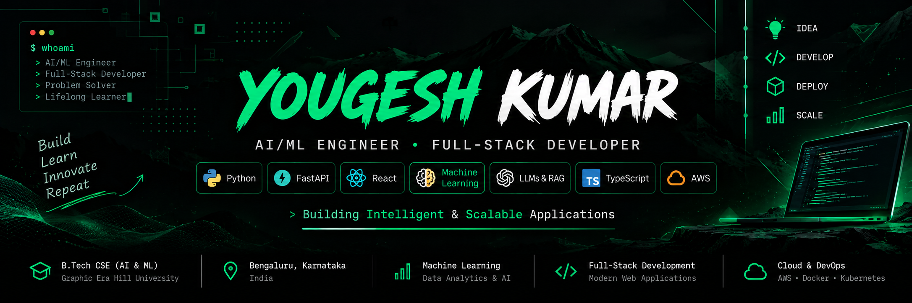

 <div align="center">
  

  <br />

  ### `$ whoami` → AI/ML Engineer · Full-Stack Developer

  

  <br />

  [](YOUR_PORTFOLIO_URL)
  [](https://linkedin.com/in/yougeshkumar22)
  [](https://github.com/Yougeshkumar)
  [](mailto:yougeshkumar8809@gmail.com)
</div>

---

## `> init profile`

```yaml
name        : Yougesh Kumar
role        : AI/ML Engineer & Full-Stack Developer
location    : Bengaluru, Karnataka, India
education   : B.Tech CSE (AI & ML), Graphic Era Hill University
focus       : Machine Learning · LLMs · RAG · Full-Stack Development
languages   : Python · Java · C++ · JavaScript · TypeScript · SQL
backend     : FastAPI · Flask · Node.js · Express.js
frontend    : React.js · TypeScript · Tailwind CSS
ai_stack    : Scikit-learn · TensorFlow · XGBoost · LangChain · Qdrant
cloud       : AWS · EC2 · S3 · Docker · Kubernetes
status      : Open to AI/ML, Software Engineering & Full-Stack Roles
motto       : Build Intelligent Systems. Solve Real Problems.
```

---

## `> ls ./tech-stack`

<div align="center">

### 🔤 Languages


### 🎨 Frontend Development


### ⚙️ Backend & APIs


### 🤖 AI, Machine Learning & GenAI


### 🗄️ Databases


### ☁️ Cloud, DevOps & Automation


### 📚 Core Computer Science


</div>

---

## `> cat experience.log`

<details open>
<summary><b>💼 AI/ML Intern — Suketa</b> | <code>Feb 2026 – May 2026</code></summary>

**LLM Document Extraction Benchmark**

```diff
+ Developed an LLM-based document extraction benchmarking system
+ Evaluated structured and unstructured enterprise documents
+ Compared extraction accuracy, response quality, and inference latency
+ Improved extraction performance through prompt engineering
+ Analyzed results across multiple prompting strategies and document formats
```

**RAG Question–Answer Generation**

```diff
+ Built a Retrieval-Augmented Generation (RAG) pipeline
+ Generated context-aware question–answer pairs from enterprise documents
+ Implemented document chunking and embedding generation
+ Integrated semantic retrieval using LangChain and Qdrant
+ Optimized chunking and prompts to improve retrieval relevance
```

**Technologies:** Python, LLMs, Prompt Engineering, LangChain, Qdrant, OpenAI API

</details>

---

## `> ls ./projects --verbose`

### 🔷 AI-Powered Fraud Detection System with RPA

**Stack:** Python · XGBoost · FastAPI · React · SHAP · SMOTE · SQLite · UiPath

An end-to-end fraud detection platform combining machine learning, explainable AI, a web dashboard, and automated response workflows.

| Feature | Details |
|---|---|
| 📊 Dataset | IEEE-CIS Fraud Detection — 590K+ transactions |
| 🤖 ML Model | XGBoost-based fraud prediction |
| 🎯 Accuracy | 98.18% |
| 🔍 Precision | 89.35% |
| 📈 F1-score | 67.62% |
| 📉 AUC-ROC | 95.22% |
| 🧠 Explainability | SHAP-based model explanations |
| ⚡ API | FastAPI backend with React dashboard |
| 🔄 Automation | UiPath workflows for alerts, case generation, reporting and audit logs |
| 🚀 Response | Under 2 seconds end-to-end response time |

[](YOUR_FRAUD_DETECTION_REPO_URL) [](YOUR_FRAUD_DETECTION_DEMO_URL)

---

### 🔷 Diabetes Prediction System

**Stack:** Python · Flask · Scikit-learn · Pandas · NumPy

A machine learning application that predicts diabetes risk using patient data and provides an interactive web interface for real-time predictions.

| Feature | Details |
|---|---|
| 🧠 Machine Learning | Scikit-learn classification models |
| 🎯 Accuracy | 97.45% |
| 🔍 Precision | 95.32% |
| 📈 Recall | 94.91% |
| 📊 F1-score | 95.11% |
| 🧹 Data Processing | Preprocessing and feature scaling |
| ⚙️ Backend | Flask REST API |
| 🌐 Deployment | Render-hosted web application |

[](YOUR_DIABETES_REPO_URL) [](YOUR_DIABETES_DEMO_URL)

---

### 🔷 Student Management System

**Stack:** Bash · React · TypeScript · Vite · Tailwind CSS · CSV

A role-based student management application designed to manage academic workflows through a responsive web interface and a lightweight shell-script backend.

| Feature | Details |
|---|---|
| 👥 Role Management | Administrator, Teacher and Student |
| 📚 Courses | Course management and enrollment |
| 📅 Attendance | Attendance tracking |
| 📝 Academics | Examination and grading modules |
| 🔐 Authentication | Role-based access and authentication |
| 🖥️ Frontend | React + TypeScript |
| 💾 Storage | CSV-based data persistence |

[](YOUR_STUDENT_SYSTEM_REPO_URL)

---

## `> cat achievements.txt`

```text
🎓 B.Tech CSE (AI & ML) — Graphic Era Hill University
🤖 AI/ML internship experience at Suketa
📊 98.18% accuracy in the fraud detection project
🩺 97.45% accuracy in the diabetes prediction project
🧠 Hands-on experience with LLM evaluation and RAG pipelines
⚡ Automated fraud response workflows with sub-2-second response time
☁️ Knowledge of AWS, Docker, Kubernetes and cloud deployment
📜 Microsoft Power BI Data Analyst Associate certification
```

---

## `> ls ./certifications`

- **Microsoft Power BI Data Analyst Associate** — 2025
- **Google Cloud Machine Learning Engineer** — Training, 2024
- **Machine Learning with Python — SLOG Solutions** — 2023

---

## `> git stats`

<div align="center">


</div>

---

## `> echo $PHILOSOPHY`

```python
# yougesh.py

class Yougesh:
    def __init__(self):
        self.focus = [
            "Artificial Intelligence",
            "Machine Learning",
            "LLMs & RAG",
            "Full-Stack Development",
            "Cloud & Automation"
        ]

    def get_motto(self):
        return "Build. Learn. Innovate. Repeat."


if __name__ == "__main__":
    developer = Yougesh()
    print(developer.get_motto())
```

---

<div align="center">

### `> let's_connect --open-to-opportunities`

```text
┌──────────────────────────────────────────────┐
│  👨‍💻  Yougesh Kumar                          │
│  📍  Bengaluru, Karnataka, India             │
│  📧  yougeshkumar8809@gmail.com              │
│  💼  AI/ML · GenAI · Python · Full-Stack      │
│  🟢  Open to Relevant Opportunities          │
└──────────────────────────────────────────────┘
```

[](https://linkedin.com/in/yougeshkumar22)
[](mailto:yougeshkumar8809@gmail.com)

*"Build Intelligent Systems. Solve Real Problems."*


</div>
